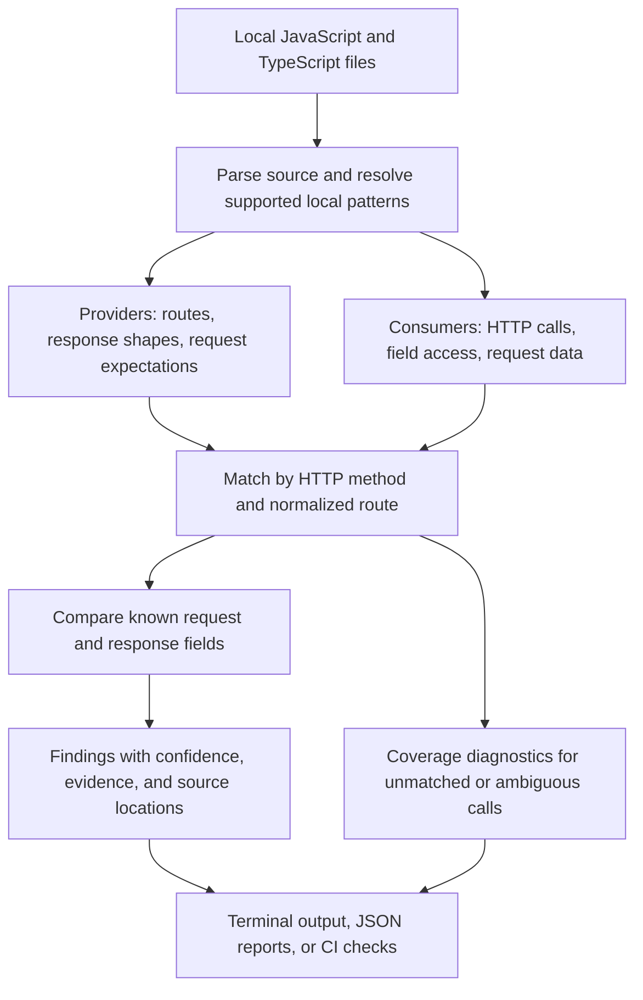

<p align="center">
  <picture>
    <source media="(prefers-color-scheme: dark)" srcset="https://raw.githubusercontent.com/frostfire575/api-tripwire/main/docs/assets/logo-white.svg">
    
  </picture>
</p>

<h1 align="center">api-tripwire</h1>

<p align="center"><strong>API contract drift detection for JavaScript and TypeScript.</strong></p>

<p align="center">
  <a href="#quick-start">Quick start</a> · <a href="#how-it-works">How it works</a> · <a href="#supported-frameworks-and-clients">Framework support</a> · <a href="#github-actions">CI setup</a>
</p>

[](https://www.npmjs.com/package/api-tripwire)
[](https://github.com/frostfire575/api-tripwire/actions/workflows/ci.yml)
[](LICENSE)
[](https://www.npmjs.com/package/api-tripwire)
[](src/index.ts)
[](CONTRIBUTING.md)

**api-tripwire is a local static analysis tool that finds likely mismatches between your backend API and the code calling it.** It reads JavaScript and TypeScript source files, matches HTTP client calls to backend routes, and checks whether the fields clients use agree with the request and response shapes it can infer.

Use it to catch a frontend reading a renamed response field or sending a request that misses a required field—before the change reaches production. It works with common Express, Fastify, Hono, and Next.js patterns, requires no running server, and provides terminal output, JSON reports, and CI exit codes.

## Why use api-tripwire?

- **Catch drift during development.** Find consumers that still read a response field after a backend change.
- **Check both sides of a request.** Compare response field access and recognized request body/query expectations.
- **Start with your existing code.** Most projects need no configuration or separate API schema.
- **Find the source of a mismatch.** Findings include consumer/provider locations, confidence, and supporting evidence.
- **Add contract checks to CI.** Set a failure threshold and baseline existing findings when adopting the tool.
- **Use reports in scripts and AI coding tools.** Export versioned JSON or call the typed ESM API.
- **Keep analysis local.** Scans do not execute your application or configuration, make network requests, or upload source code.

An **API contract** describes the data a route accepts and returns. **Contract drift** happens when the provider and its consumers disagree about that data. Here, a **provider** is a backend route handler and a **consumer** is code making an HTTP request.

## Table of contents

- [Quick start](#quick-start)
- [Example: catch a renamed response field](#example-catch-a-renamed-response-field)
- [How it works](#how-it-works)
- [Supported frameworks and clients](#supported-frameworks-and-clients)
- [Commands](#commands)
- [Configuration](#configuration)
- [Confidence, coverage, and exit codes](#confidence-coverage-and-exit-codes)
- [GitHub Actions](#github-actions)
- [Baselines and contract snapshots](#baselines-and-contract-snapshots)
- [JSON reports and AI coding tools](#json-reports-and-ai-coding-tools)
- [Programmatic API](#programmatic-api)
- [Privacy and limitations](#privacy-and-limitations)
- [Development](#development)
- [License](#license)

## Quick start

**Requirement:** Node.js **22.12.0 or later**.

Install api-tripwire in the project you want to check:

```sh
npm install --save-dev api-tripwire
npx api-tripwire scan .
```

Scan a directory containing both the backend routes and their consumers. In a monorepo, this is usually the repository root.

Optionally, add a script to your `package.json`:

```json
{
  "scripts": {
    "check:api": "api-tripwire scan ."
  }
}
```

Then run `npm run check:api` locally or in your checks. If the report shows partial coverage or no matched contracts, inspect discovery:

```sh
npx api-tripwire doctor .
npx api-tripwire routes .
npx api-tripwire consumers .
```

**No matched contracts means unverified coverage.** An exit code of `0` alone does not prove that your APIs are compatible.

On PowerShell, use `npm.cmd` and `npx.cmd` if execution policy blocks the `.ps1` launchers.

## Example: catch a renamed response field

The backend returns `id`, but the client still reads `userId`.

**Provider — `server.ts`:**

```ts
import express from 'express';
const app = express();
app.get('/api/users/:id', (req, res) => {
  res.json({ id: 'u_123', name: 'Ada' });
});
```

**Consumer — `client.ts`:**

```ts
async function loadUser() {
  const response = await fetch('/api/users/123');
  const user = await response.json();
  return user.userId;
}
```

Run `npx api-tripwire scan .`. The finding includes:

```text
× CONFIRMED GET /api/users/:id
  Consumer reads userId, absent from all known success responses
  consumer client.ts:4:10
  provider server.ts:3:1
  Did you mean id?
```

The scan exits with code `1` at the default threshold. Review the intended contract, then update the client access to `user.id` if the backend response is correct.

To run the included example from a checkout of this repository:

```sh
npm install
npm run build
node dist/cli.js scan examples/demo
```

The demo intentionally contains this mismatch and exits with code `1`.

## How it works

api-tripwire builds a static view of providers and consumers from local source code, then compares the contracts it can resolve.



1. **Discover source files.** Read supported JavaScript and TypeScript files within the selected project root.
2. **Extract both sides.** Identify backend routes and their data shapes, along with HTTP calls and the response fields consumers access.
3. **Match endpoints.** For example, `GET /api/users/123` can match `GET /api/users/:id`. Literal routes outrank dynamic routes; equally specific matches remain ambiguous.
4. **Compare evidence.** Check consumed response fields and recognized request expectations. Unresolved structures or ambiguous matches lower confidence.
5. **Report findings and coverage.** Show what disagrees, where the evidence comes from, and which parts of the analysis remain incomplete.

Relative URLs are matched against the local route table. Absolute external URLs remain unmatched unless a statically known client base URL establishes the same origin. Deployment rewrites and proxies are outside the model.

## Supported frameworks and clients

Support covers the patterns below, with fixture and regression coverage. It is a bounded static model of each framework.

### Backend providers

| Framework          | Supported patterns                                                                                  | Main limits                                                      |
| ------------------ | --------------------------------------------------------------------------------------------------- | ---------------------------------------------------------------- |
| Express            | Imported factory/Router, HTTP method calls, literal mounts, referenced handlers                     | Computed paths, route-builder chains, middleware transformations |
| Fastify            | Shorthand methods, route objects, static plugin prefixes                                            | Dynamic plugin registration, schemas, serialization hooks        |
| Hono               | Imported Hono, HTTP method calls, mounted subapps, `c.json`, basic `c.req` usage                    | Complex middleware and validator effects                         |
| Next.js App Router | Named method exports, route groups, `[id]`, catch-all segments, `Response.json`/`NextResponse.json` | Re-exports and advanced route interception                       |
| Next.js Pages API  | Default handlers with literal `req.method === 'GET'` branches                                       | Switch-based and dynamic dispatch                                |

### HTTP consumers

| Client         | Supported patterns                                                              |
| -------------- | ------------------------------------------------------------------------------- |
| `fetch`        | Await/JSON and then/JSON flows, aliases, simple local wrappers, literal options |
| Axios          | Calls and methods, static `create` base URL, `.data`, destructuring             |
| ky             | Calls and methods, static `create` URL prefix, `.json()`                        |
| TanStack Query | Imported `useQuery`/`useSuspenseQuery`, inline `queryFn`, result `.data`        |

### Data inference

The analyzer handles simple local imports, value aliases, function-returned objects, known spreads, nested object/array access, literals, and conditional response variants. It also recognizes literal query strings and request bodies passed through `JSON.stringify`.

Request body, query, and parameter usage is collected. Destructuring alone establishes a `POSSIBLE` expectation. Recognized direct rejection guards can establish required fields; direct `typeof` rejection guards can establish primitive type requirements. Validation-library schemas and arbitrary middleware behavior are not inferred.

Parsed files, declarations, and shape summaries are cached per scan. Type checking is created lazily for unresolved type annotations and restricted to parsed project files. Type-derived object shapes remain open: type assertions and client generics do not prove runtime response structure.

## Commands

Examples below use `npx` to run the locally installed CLI. The optional `[project]` argument selects a project directory.

| Command                                                     | Purpose                                                                                 |
| ----------------------------------------------------------- | --------------------------------------------------------------------------------------- |
| `npx api-tripwire [project]`                                | Run the default scan                                                                    |
| `npx api-tripwire scan [project]`                           | Analyze contracts and report findings                                                   |
| `npx api-tripwire init [project]`                           | Explain defaults; create minimal config only for a detected example/fixture-only layout |
| `npx api-tripwire routes [project]`                         | List discovered provider routes                                                         |
| `npx api-tripwire consumers [project]`                      | List discovered HTTP consumers                                                          |
| `npx api-tripwire explain GET /api/users/:id --project app` | Inspect one method and normalized route                                                 |
| `npx api-tripwire doctor [project]`                         | Inspect environment and coverage diagnostics                                            |
| `npx api-tripwire ci [project]`                             | Run a CI scan                                                                           |
| `npx api-tripwire ci [project] --baseline`                  | Run CI with saved findings suppressed                                                   |
| `npx api-tripwire baseline [project]`                       | Save current findings as a baseline                                                     |
| `npx api-tripwire scan [project] --save-contracts`          | Save a contract snapshot                                                                |
| `npx api-tripwire diff [project]`                           | Compare current contracts with the saved snapshot                                       |

### CLI options

| Option                                | Availability               | Behavior                                          |
| ------------------------------------- | -------------------------- | ------------------------------------------------- |
| `--json`                              | Every command              | Emit versioned JSON                               |
| `--debug`                             | Every command              | Write analysis details to stderr                  |
| `--no-color`                          | Every command              | Disable terminal colors                           |
| `--fail-on confirmed\|high\|possible` | Default scan, `scan`, `ci` | Override the failure threshold; default is `high` |
| `--help`                              | CLI and subcommands        | Show usage                                        |
| `--version`                           | CLI                        | Show the installed version                        |

`NO_COLOR` also disables colors. Redirected output is plain, and CI output omits decorative symbols.

## Configuration

Most projects work with the defaults. For a monorepo or custom layout, save this as `api-tripwire.config.ts` in the scan root:

```ts
import { defineConfig } from 'api-tripwire';

export default defineConfig({
  include: ['apps/**/*.{ts,tsx,js,jsx}', 'packages/**/*.{ts,tsx,js,jsx}'],
  exclude: ['**/generated/**'],
  confidence: 'high',
  clients: ['internalFetch'],
});
```

| Setting      | Purpose                                                                 | Default                                           |
| ------------ | ----------------------------------------------------------------------- | ------------------------------------------------- |
| `include`    | Source file globs relative to the project root                          | JS, JSX, TS, and TSX files, with exclusions below |
| `exclude`    | Additional exclusion globs                                              | No additional exclusions                          |
| `confidence` | Default CI/scan failure threshold                                       | `'high'`                                          |
| `clients`    | Additional function names to inspect as fetch-style URL/options clients | No additional client names                        |

`confidence` controls failure decisions; all findings remain in the report. CLI `--fail-on` takes precedence. Adding a name to `clients` opts into discovery and does not certify arbitrary wrapper transformations.

### Project and file discovery

- An explicit project argument selects the scan root. Otherwise, discovery searches upward for `package.json` or a Tripwire config and falls back to the working directory.
- Tests, fixtures, and examples are excluded by default inside the root. Scanning `examples/demo` directly includes its own files; a custom `include` can also opt into these directories.
- Dependencies, build outputs, coverage, Git, and Tripwire artifact directories are always excluded. Declaration files and Tripwire config files are also excluded from source analysis.
- Symlink directories are not followed. Local import resolution stays inside the project root.

### Configuration safety

Supported names are `api-tripwire.config.ts`, `api-tripwire.config.js`, and their dot-prefixed equivalents.

Configuration is parsed as source and never executed. Use a literal exported object or the `defineConfig` import/call shown above. Variables, executable expressions, getters, spreads, arbitrary calls, and dynamic imports are rejected. `init` never overwrites an existing file.

## Confidence, coverage, and exit codes

Confidence describes the evidence behind a finding. Coverage describes how much of the discovered code the analyzer could resolve. Check both when interpreting a report.

### Finding confidence

| Level       | Meaning                                                                                                                               |
| ----------- | ------------------------------------------------------------------------------------------------------------------------------------- |
| `CONFIRMED` | One resolved route; a consumed field is absent from every relevant known success variant, with no structural uncertainty at that path |
| `HIGH`      | Strong evidence requiring an inference step, such as a missing request field explicitly rejected by a runtime guard                   |
| `POSSIBLE`  | Partial response variants, unknown status, ambiguous routes, optional access, or request usage without a rejection guard              |
| `UNKNOWN`   | Coverage information; never independently fails CI                                                                                    |

The default threshold, `high`, fails on unsuppressed errors with `CONFIRMED` or `HIGH` confidence. Use `--fail-on confirmed` for only confirmed errors, or `--fail-on possible` to include possible errors. Warnings and `UNKNOWN` diagnostics never fail CI.

Recognized error responses are separate from success responses. Unknown status lowers confidence. Known keys with unknown values remain distinct from unknown object structure, and unknown spreads may overwrite earlier values. Optional or guarded accesses produce warnings; conservative guard handling can lower confidence more than necessary. Findings report the highest missing response ancestor at each observed consumption site. Rename suggestions never increase confidence.

### Coverage status

| Status       | Meaning                                                                                            |
| ------------ | -------------------------------------------------------------------------------------------------- |
| `analyzed`   | At least one uniquely matched consumer, with no recorded diagnostics or incomplete route responses |
| `partial`    | At least one uniquely matched consumer, with diagnostics or incomplete route responses             |
| `unverified` | No uniquely matched consumers                                                                      |

Coverage describes recognized patterns. Even `analyzed` does not prove that every route or runtime behavior was discovered.

### Exit codes

| Code | Meaning                                                                                               |
| ---- | ----------------------------------------------------------------------------------------------------- |
| `0`  | No unsuppressed error reached the threshold, or an inspection/artifact command completed successfully |
| `1`  | A scan or CI check found qualifying API contract drift                                                |
| `2`  | Tool, configuration, or requested artifact failure                                                    |

## GitHub Actions

Install api-tripwire as a development dependency and commit your lockfile. Then add a workflow such as `.github/workflows/api-contracts.yml`:

```yaml
name: API contracts
on: [push, pull_request]

jobs:
  contracts:
    runs-on: ubuntu-latest
    steps:
      - uses: actions/checkout@v4
      - uses: actions/setup-node@v4
        with:
          node-version: '24'
          cache: npm
      - run: npm ci
      - run: npx --no-install api-tripwire ci .
```

Qualifying findings produce GitHub Actions error annotations. Use `--json` for machine-readable output; this suppresses stdout annotations.

To adopt the tool while retaining existing findings, create and commit a baseline, then change the final command to `npx --no-install api-tripwire ci . --baseline`.

## Baselines and contract snapshots

A **baseline** records existing findings for suppression. A **snapshot** records inferred contracts for later comparison. Each is written only when explicitly requested.

### Baseline existing findings

```sh
npx api-tripwire baseline .
npx api-tripwire ci . --baseline
```

`baseline` atomically writes `.api-tripwire-baseline.json`. Matching findings stay in reports with `suppressed: true` and no longer trigger failure. A missing or malformed explicitly requested baseline exits with code `2`.

Finding IDs use the route, issue kind, field, relative consumer file, and normalized source context rather than line numbers. A baseline acknowledges existing findings; review them before suppressing them.

### Compare saved contracts

```sh
npx api-tripwire scan . --save-contracts
# Make changes to your API, then compare against the saved snapshot.
npx api-tripwire diff .
```

`scan --save-contracts` writes `.api-tripwire/contracts.json`. `diff` reads that snapshot without modifying it and reports additions, removals, type/optionality changes, uncertainty changes, and currently related consumers. Response removals and newly proven required request fields are marked potentially breaking.

**`diff` is an inspection command:** it exits with code `0` even for potentially breaking changes. Use `ci` for threshold-based failure checks. Git-ref comparison is not supported.

Route fingerprints use `at_` followed by SHA-256 over canonical request/response structures, excluding locations and timestamps. To share baselines or snapshots with your team, remove matching ignore rules or explicitly add the files to Git.

## JSON reports and AI coding tools

Export a scan report for automation, code review, or an AI coding assistant:

```sh
npx api-tripwire scan . --json > tripwire.json
```

The command retains normal scan exit codes, including `1` for qualifying findings. Successful JSON stdout contains only JSON; debug output goes to stderr. Reports omit timing and timestamps for deterministic output. The root path is absolute; source locations use relative paths with `/` separators.

### Report structure

Scan reports use `schemaVersion: "1"`:

| Field         | Contents                                                                            |
| ------------- | ----------------------------------------------------------------------------------- |
| `summary`     | Counts of files, routes, consumers, matches, issues, and suppressions               |
| `routes`      | Provider routes, request expectations, response shapes, locations, and fingerprints |
| `consumers`   | HTTP calls, response field accesses, request data, and matched route IDs            |
| `issues`      | Findings with confidence, severity, evidence, and suppression state                 |
| `diagnostics` | Analysis uncertainty and discovery diagnostics                                      |
| `coverage`    | Matched/unmatched counts, incomplete route count, and coverage status               |
| `environment` | Detected package manager, languages, and frameworks                                 |
| `root`        | Absolute project root                                                               |
| `confidence`  | Configured failure threshold; a CLI `--fail-on` override affects the exit decision  |

Each issue includes `id`, `kind`, `confidence`, `severity`, `method`, `route`, `field`, `message`, `expected`, `actual`, `suggestion`, `consumer`, `provider`, `evidence`, and `suppressed`. Unavailable issue values are explicit `null`s. Inspection commands return command-specific JSON; tool failures with `--json` return `schemaVersion` and `error`.

### Suggested workflow for an AI coding assistant

1. Run `scan --json` and check `coverage` and `diagnostics` before interpreting the findings.
2. Read each issue's `consumer`, `provider`, and `evidence` to inspect the relevant source code.
3. Confirm the intended API contract before changing either side. Treat rename suggestions as hints.
4. Make the appropriate change, rerun the scan, and run the project's relevant tests.

For a closer look at a single endpoint:

```sh
npx api-tripwire explain GET /api/users/:id --project . --json
```

## Programmatic API

The package exposes a typed ESM API:

```ts
import { scan, defineConfig, type Report } from 'api-tripwire';

const config = defineConfig({ confidence: 'high' });
const report: Report = await scan('./app', config);

console.log(report.coverage);
console.log(report.issues);
```

`scan(project?, overrides?)` returns all findings and performs no artifact writes. Overrides take precedence over the project's configuration. TypeScript declarations and public report/configuration types are included; see [the exports](src/index.ts) and [type definitions](src/core/models.ts).

## Privacy and limitations

Analysis runs locally, with no telemetry, uploads, application execution, configuration execution, or network requests. Installing npm dependencies is a separate operation that may access the registry. Reports can contain source locations and inferred literal values; handle report artifacts like source code.

The analyzer has incomplete coverage of runtime-generated routes, arbitrary middleware and serializer changes, reflective objects, complex control flow, reassignment-heavy data flow, deep or cyclic wrappers, and unresolved imports. Unsupported framework syntax may be omitted. `doctor` and coverage summaries expose recognized uncertainty but cannot enumerate every omitted pattern.

Use api-tripwire alongside type checking, validation, integration tests, and runtime monitoring. An absence of findings does not prove compatibility.

## Development

From a checkout of this repository:

```sh
npm install
npm run build
npm run typecheck
npm run lint
npm run format:check
npm test
npm run verify:fixtures
npm run verify:package
```

Build before running tests: CLI tests exercise `dist/cli.js`. The package check packs a tarball, installs it into a temporary project, checks the demo's expected exit code, imports the public API, and compiles a declaration consumer. It may fetch dependencies from the registry and uses local `npx` without registry fallback.

To try a local package tarball:

```sh
npm pack
npm install --save-dev /path/to/api-tripwire-<version>.tgz
npx --no-install api-tripwire scan .
```

Replace `<version>` with the version in the generated filename, and run the install command in the project you want to analyze.

See [CONTRIBUTING.md](CONTRIBUTING.md) for contribution guidance, [VERIFICATION.md](VERIFICATION.md) for verification details, and [the CI workflow](.github/workflows/ci.yml) for Windows, Linux, and macOS package checks. Release notes are in [CHANGELOG.md](CHANGELOG.md) and [GitHub releases](https://github.com/frostfire575/api-tripwire/releases).

## License

[MIT](LICENSE).
